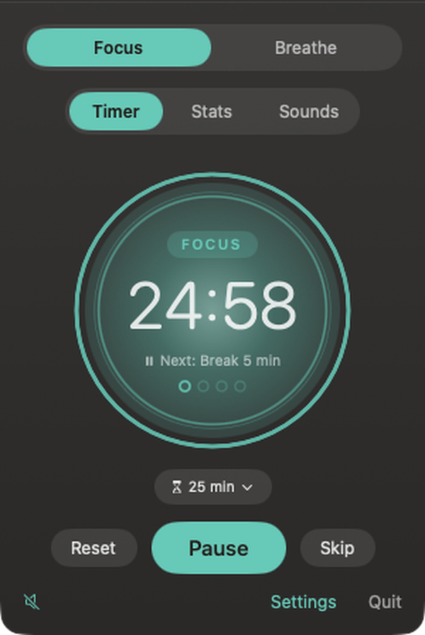

# Tarn

A tarn is a small, still mountain lake. Tarn is a calm Mac menu bar app for focus and for breathing.

Free and open source. No account, no tracking. Made by Antelis Labs.

## What it does
- **Focus:** Pomodoro rounds (15, 25, 45, 60 or 90 minutes) with calm, timed breaks. A glowing circle narrows as time runs out, dots show your place in the set, and breaks open into a gentle breathing guide. Click the circle to start or pause. Optional daily schedule, stats, an intention line and a color theme of your choice.
- **Breathe:** a slow breathing picture, a flower or water, with four patterns (Settle, Deep, Box, 4 7 8), optional gentle prompts and spoken cues, and 1 to 20 minute sessions. Switching to Breathe never stops a running focus round. While you breathe, the controls fade away so only the picture and the word remain.
- **Calm mode:** one button for full screen, your last sound mix and Hide apps (which only hides, never quits). Click anywhere or press Esc to return, and the sound fades out as your cue to get back. One switch in Settings turns full screen and hiding off completely.
- **Sounds:** optional recorded ambient loops (ocean, forest, birds, stream) with presets and a fade out timer. Tarn makes no sound at all until you turn something on.

### A closer look

| Focus | Running | Break |
|---|---|---|
|  |  |  |

| Breathe, flower | Breathe, water | Sounds |
|---|---|---|
|  |  |  |

| Settings | Settings, Breathe | Your color |
|---|---|---|
|  |  |  |

macOS only for now. Timer, breathing and sound logic is kept apart from the interface so other platforms stay possible later.

See [docs/MANUAL.md](docs/MANUAL.md) for the manual and FAQ.

## Install
Download `Tarn.dmg`, open it and drag Tarn to Applications. Tarn needs macOS 14 or later. It lives in the menu bar as a small flower. If you cannot see the icon (a crowded menu bar or the notch can hide it), run `tarnctl window`, or open Tarn from Applications and click its Dock icon after turning on "Show Tarn in the Dock" in Settings. On the first launch Tarn also opens a window.

## Build
`./build.sh` builds `build/Tarn.app`. Add `run` to launch it.

## Command line
`Tools/install-cli.sh` links `tarnctl` onto your PATH. Examples: `tarnctl start 45`, `tarnctl break`, `tarnctl breathe full`, `tarnctl sound forest`, `tarnctl clear` (hides other windows, never quits apps), `tarnctl restore`, `tarnctl status`, `tarnctl window` (open Tarn in a normal window), `tarnctl settings`. It talks to the app through `tarn://` links, so Shortcuts and Raycast can use them too. Note that any web page can open a `tarn://` link, so these links can only start, pause or stop timers, hide windows or open full screen breathing; they cannot read files or run anything.

## Release
`Tools/release.sh` builds a universal app, signs, notarizes and makes a DMG.

## Sounds and credits
Every sound is CC0 or self made. See `SOURCES.md` for the source, license and URL of each file.

## License
MIT. See `LICENSE`.
