# Tarn

A tarn is a small, still mountain lake, quiet enough to hold the sky. Tarn is a calm Mac menu bar app for focus and for breathing: work in focused rounds, then breathe like still water.

**[Download Tarn for Mac](https://github.com/jakeantelis/Tarn/releases/latest/download/Tarn.dmg)**  Free. Needs macOS 14 or newer.

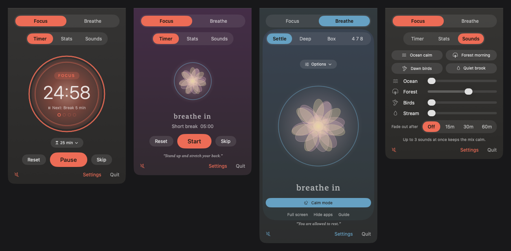

Free and open source. No account, no tracking, and it only goes online when you press Check for updates. Made by [Antelis Labs](https://antelislabs.com).

<p align="center">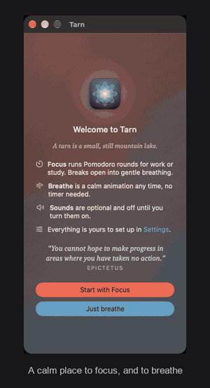</p>

<p align="center">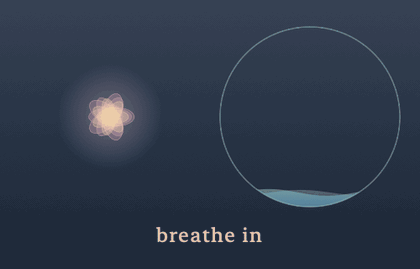</p>

## What it does

**Focus.** Pomodoro rounds of 15, 25, 45, 60 or 90 minutes with calm, timed breaks. A glowing circle narrows as time runs out, dots show your place in the set, and a break opens into a gentle breathing guide that waits until you are ready. Click the circle to start or pause. Choose from ten color themes, keep daily stats, and set a daily schedule so rounds and breaks run on their own between two times.

**Breathe.** A slow breathing picture, a flower or water, with four rhythms (Settle, Deep, Box and 4 7 8), optional written prompts and sessions from 1 to 20 minutes. It plays a soft sound by default, which one switch turns off. While you breathe the controls fade and the picture grows to fill the window.

**Guided meditation, when you want it.** Breathe stays quiet unless you ask for a voice. In Breathe, click Guided meditation and choose 5, 10 or 20 minutes. A recorded voice (Soft, Warm or Grounded) guides you with long stretches of silence, the words being spoken appear under the picture, and your sound mix plays softly underneath, with a small mixer for the voice, the nature sound and which sound plays. Afterwards the sound drifts away over 30 seconds, or stays on for a few minutes if you prefer. One switch in Settings hides it if you never use it.

**Floating circle.** A small frosted circle stays above your other windows and shows the Focus timer, or the breathing picture in Breathe. Drag it anywhere, click it to start or pause, hover for a sound button, or close it with the X. Pick one of four sizes, or turn it off, in Settings, Focus.

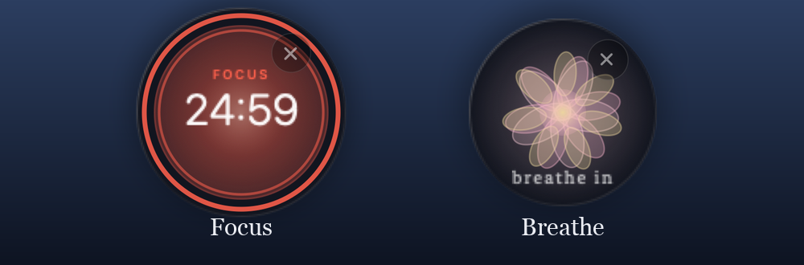

**Calm mode.** One button for full screen, your last sound mix and Hide other apps, which only hides and never quits anything. Click anywhere or press Esc to return, and the sound fades out as your cue to get back. One switch in Settings turns full screen and hiding off completely.

**Sounds.** Recorded ambient loops (ocean, forest, birds and stream) with presets, a mixer and a fade out timer. Focus is silent until you turn sounds on.

**Built to stay out of the way.** Lives in the menu bar as a small flower. No account, no tracking, and no network use except when you press Check for updates. It never speaks, and it never fills your screen unless you ask.

### A closer look

| Focus | Running | Break |
|---|---|---|
| 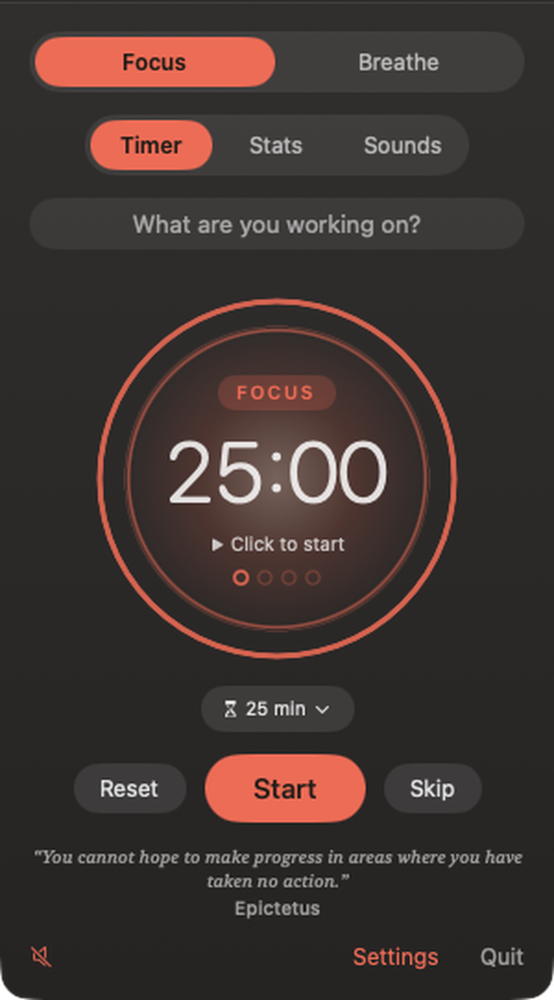 | 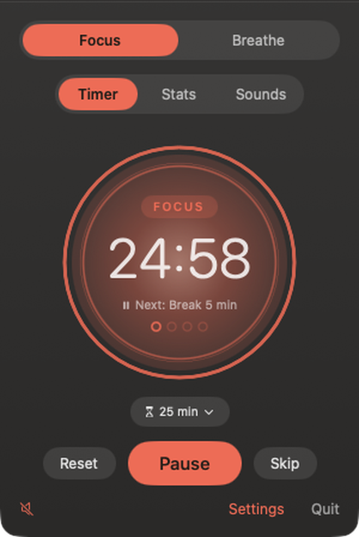 | 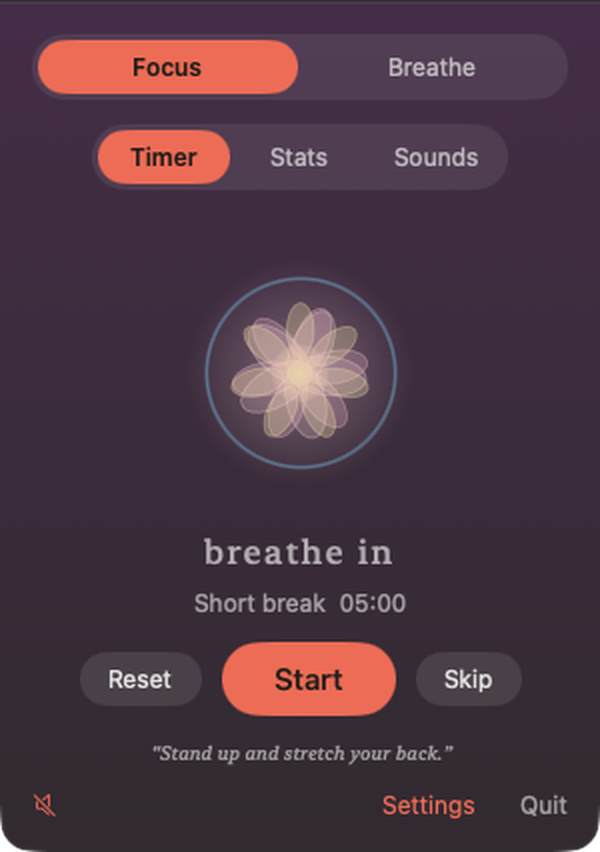 |

| Breathe, flower | Breathe, water | Sounds |
|---|---|---|
| 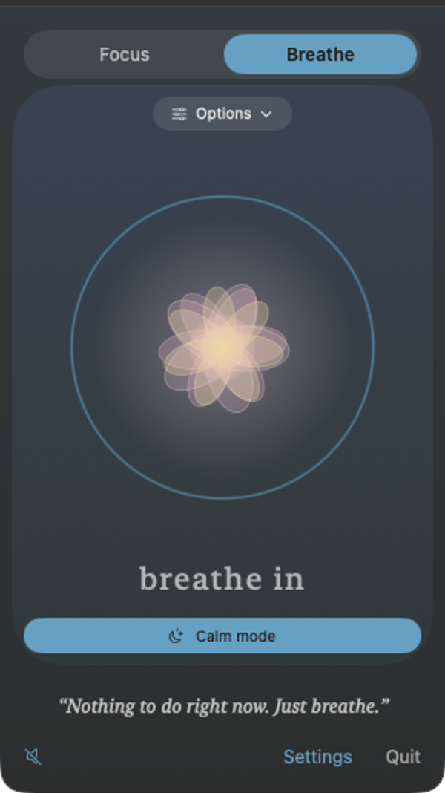 | 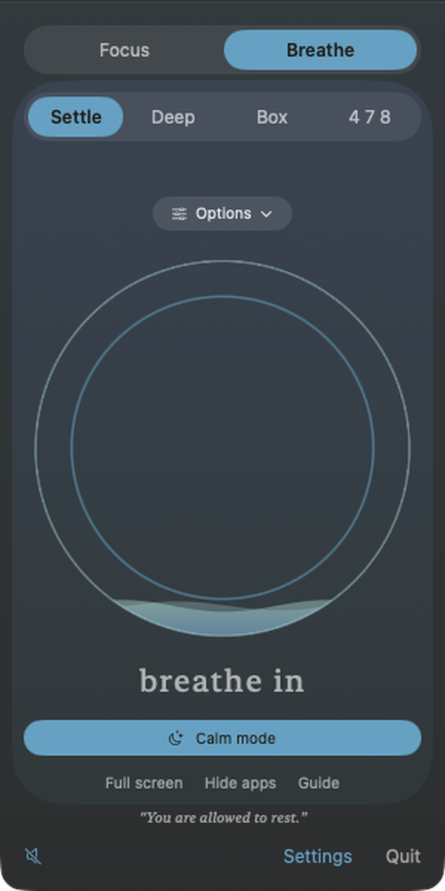 | 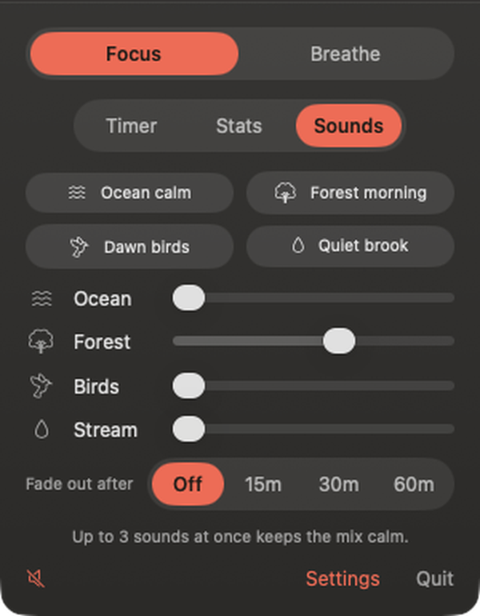 |

| Focus settings | Breathe settings | General |
|---|---|---|
| 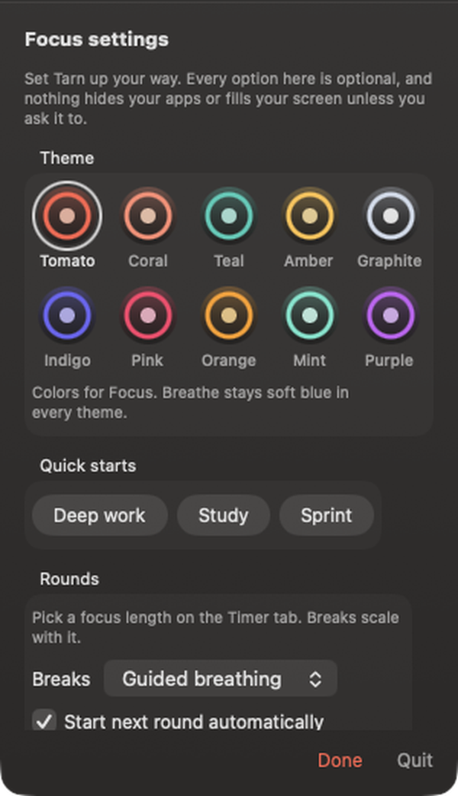 | 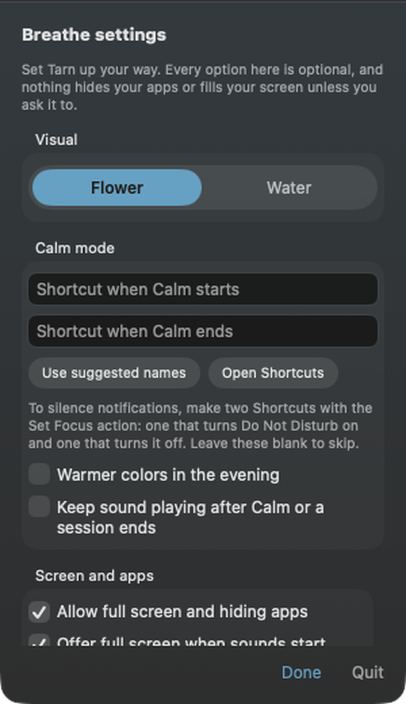 | 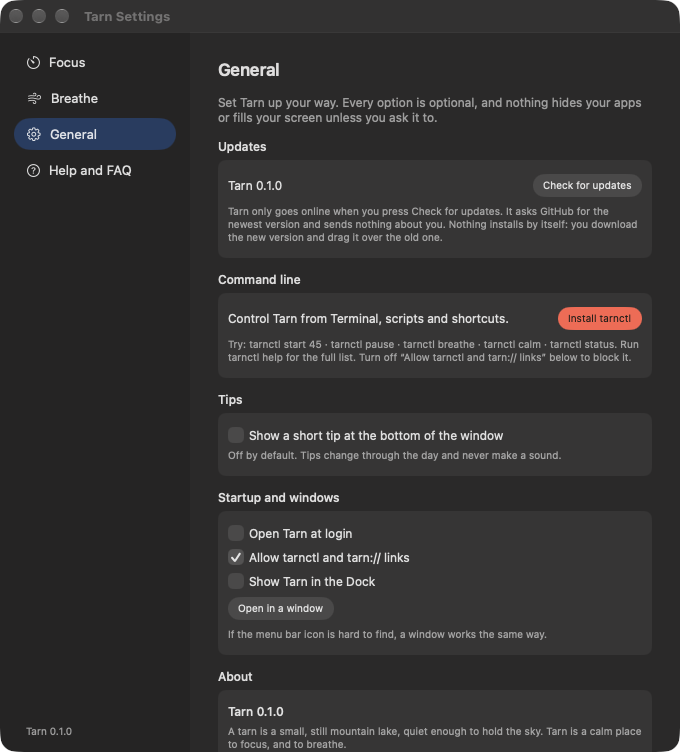 |

macOS only for now. Timer, breathing and sound logic is kept apart from the interface, so other platforms stay possible later.

See [docs/MANUAL.md](docs/MANUAL.md) for the manual and FAQ. There is also a searchable Help inside the app.

## Install
Works on any Mac with macOS 14 Sonoma or newer, Apple silicon or Intel. To check, choose About This Mac from the Apple menu.

1. [Download Tarn.dmg](https://github.com/jakeantelis/Tarn/releases/latest/download/Tarn.dmg) and open it.
2. Double click Tarn and choose Move to Applications, or drag Tarn onto the Applications folder in the same window.
3. Click the small flower in your menu bar.

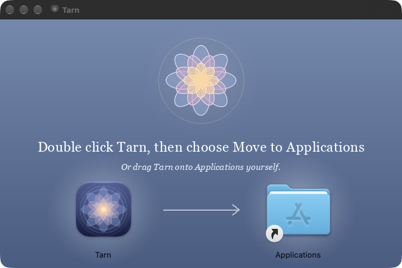

Keep Tarn in Applications, because it will not keep working from the disk image. If macOS asks whether to open an app from the internet, choose Open. If the flower is hidden by a crowded menu bar or the notch, turn on "Show Tarn in the Dock" in Settings.

**Updates.** Open Settings, General and press Check for updates. Tarn never checks by itself.

## Command line
In the app, open Settings, General and press Install tarnctl (no password needed). From a source checkout, `Tools/install-cli.sh` does the same.

```
tarnctl start 45        start a 45 minute round
tarnctl pause           pause (tarnctl resume continues)
tarnctl break           start a break now
tarnctl breathe full    open Breathe in full screen
tarnctl calm            full screen, sound and Hide other apps
tarnctl sound forest    play a sound preset
tarnctl clear           hide other windows (restore brings them back)
tarnctl status          show what Tarn is doing
tarnctl window          open Tarn in a normal window
```

It talks to the app through `tarn://` links, so Shortcuts and Raycast can use them too. Any web page can open a `tarn://` link, so these links can only start, pause or stop timers, hide windows or open full screen breathing. They cannot read files or run anything. You can switch them off in Settings.

## Build
`./build.sh` builds `build/Tarn.app`. Add `run` to launch it. `Tools/run-tests.sh` runs the logic tests, and `Tools/release.sh` builds a universal app, signs it, notarizes it and makes the DMG.

## Sounds and credits
Every ambient sound is CC0 or self made. See [SOURCES.md](SOURCES.md) for the source, license and link of each file. The recorded loops come from BigSoundBank.

The guided meditation voices are credited in [SOURCES.md](SOURCES.md). See License below for their terms.

## More from Antelis Labs
See [antelislabs.com](https://antelislabs.com) for everything else.

[**Matcha**](https://github.com/jakeantelis/Matcha) keeps your Mac awake for builds, exports and long running tasks. Tiny app, command line tool and crash safe. It pairs well with Tarn: let Matcha hold the Mac awake while Tarn holds your focus.

## License
The guided meditation recordings are © 2026 Antelis Labs LLC and may not be reused or redistributed outside Tarn. Everything else in this project is MIT licensed. See [LICENSE](LICENSE).
